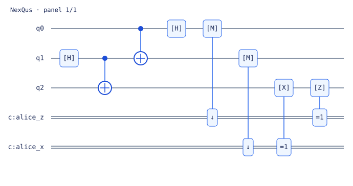

# NexQus SDK

Quantum circuit simulation on NumPy CPU and optional PyTorch CPU/NVIDIA CUDA,
with noise channels, reusable algorithms, analytic gradients and Burmese/English
tutorials. NexQus implements its own circuit representation and evolution kernels;
other quantum SDKs are not execution dependencies.

**Version 1.1.0 · MIT license.**
[Source and issue tracking](https://github.com/Inn0m1n4te030/NexQus-SDK).

## Install

In an activated Python 3.10+ virtual environment:

```bash
python -m pip install nexqus-sdk==1.1.0
```

The distribution name is **nexqus-sdk**; the Python import is **nexqus**.
For editable development from a source checkout, use `python -m pip install -e .`.
Examples and notebooks are available in the source repository and source archive.

## Your first circuit

```python
from nexqus import Circuit, Simulator

q = Circuit(2).h(0).cx(0, 1)
result = Simulator().run(q, shots=1000, seed=42)
print(result.probabilities)       # [0.5, 0, 0, 0.5], up to roundoff
print(result.counts)              # samples of 00 and 11
print(result.expectation('ZZ'))   # approximately 1
```

**Bit order:** q0 is the leftmost, most significant bit. `Circuit(2).x(0)` prepares
`10`. Angles use radians. `shots=0` returns probabilities without sampling counts.

## Functions, parameters and learning

```python
from nexqus import circuit, Parameter, QuantumFunction, Simulator

@circuit(2)
def block(q, theta):
    # ပထမ qubit ကို rotate လုပ်ပြီး ဒုတိယ qubit နှင့် ချိတ်ဆက်ပါ။
    q.ry(theta, 0).cx(0, 1)

theta = Parameter('theta')
template = block(theta)
function = QuantumFunction(template, 'ZI')
value, gradient = function.value_and_grad({'theta': 0.4})

sim = Simulator()
results = sim.run_sweep(template, [{'theta': 0.0}, {'theta': 1.0}], shots=0, seed=42)
prepared = sim.compile(template.bind({'theta': 0.4}))
result = prepared.run(shots=1000, seed=42)
```

Parameter-shift differentiation supports RX, RY, RZ, P and CP with shared
parameters and arithmetic chain rules. `QuantumRegressor`,
`QuantumBinaryClassifier`, Adam and SGD support small explicit learning loops.
Gradients require static noiseless or exact-density circuits. They do not expose
Torch autograd, sampled trajectory gradients or dynamic-circuit gradients.

## Noisy simulation

```python
from nexqus import Noise, NoiseModel, Simulator, algorithms

noise = NoiseModel(Noise.depolarizing(0.02), Noise.amplitude_damping(0.01))
exact = Simulator().run(algorithms.bell(), noise=noise, shots=0)
sampled = Simulator(method='trajectory').run(
    algorithms.ghz(10), noise=noise, trajectories=1000,
    batch_size=32, shots=1000, seed=7,
)
```

| Method | Behavior | Main state storage |
|---|---|---|
| `auto` | Static statevector without noise; density with noise; exact density branches for dynamic circuits | Depends on selected mode |
| `statevector` | Pure static circuits; rejects quantum noise and dynamic controls | O(2^n) |
| `density_matrix` | Exact channels, or classical/density branching for dynamic circuits | O(4^n) per branch |
| `trajectory` | A finite ensemble of sampled pure-state histories | O(B × 2^n), batch size B |

Built-in channels: bit flip, phase flip, depolarizing, amplitude damping and phase
damping; custom one-qubit CPTP Kraus channels are validated. Global noise is
applied after each gate to each touched wire, in channel insertion order.
Depolarizing means `(1-p)rho + p I/2`; phase damping multiplies coherences by
`sqrt(1-gamma)`. Output `readout_error` affects reported quantum bit probabilities
and counts, not the retained quantum state or intermediate classical control.

Trajectory probabilities remain Monte Carlo estimates even at `shots=0`.
Increasing shots does not increase the number of simulated histories.

## Measurement, reset and feed-forward

```python
from nexqus import Circuit, Simulator

q = Circuit(1).h(0).measure(0, 'm').x(0).c_if('m', 1)
result = Simulator().run(q, shots=1000, seed=42)
print(result.counts)              # {'0': 1000}
print(result.classical_counts)    # intermediate measurement results
```

Single-bit conditions, overwritable classical keys, reset, joint
classical/quantum counts and reduced density matrices are supported.
`algorithms.teleportation()` supplies a complete feed-forward protocol.
Exact branching is limited by `max_branches` and estimated memory.

## CPU and CUDA

```python
from nexqus import Simulator

cpu = Simulator()
torch_cpu = Simulator(backend='torch')
gpu = Simulator(backend='torch', device='cuda:0', precision='single')
```

Install a compatible PyTorch build using the official
[PyTorch installation guide](https://pytorch.org/get-started/locally/).
The `gpu` extra declares optional PyTorch; it cannot guarantee a CUDA-enabled
build for your machine. Unsupported CUDA execution raises an error.
There is no silent CPU fallback. Results use NumPy arrays on the host.
Only CPU and NVIDIA CUDA are supported; CPU can be faster for small circuits.

## Qubit and memory limits

There is no universal fixed qubit capacity. Statevector storage doubles per
added qubit; density storage quadruples. A double-precision 20-qubit vector uses
16 MiB for the main state. One double-precision 12-qubit density uses 256 MiB.

`max_memory_mb=1024` checks an estimated six-state workspace, multiplied by
effective trajectory batch size; exact dynamic branches add further storage.
This estimate is not an allocator cap. Circuit data, cached gates, retained host
states and output-shot storage need additional memory. With the default estimate,
a static complex128 vector can reach 23 qubits and a density 11 qubits; these are
guard thresholds, not measured performance or hardware guarantees.

Benchmark your intended circuit, method and device to determine practical limits.
See the [performance guide](https://github.com/Inn0m1n4te030/NexQus-SDK/blob/main/docs/PERFORMANCE.md)
for memory, batching and CPU/GPU comparison commands.

## Learn and validate

```bash
python -m pip install '.[tutorial]'
python -m ipykernel install --user --name nexqus --display-name "Python (NexQus)"
jupyter lab notebooks
python scripts/run_notebooks.py --engine jupyter --kernel nexqus
python scripts/check_release.py
```

Seven bilingual notebooks target SDK 1.1.0 and cover circuits, native drawing,
algorithms including Shor/resources, noise, devices, gradients, learning,
measurement/reset and an end-to-end experiment. Start with
`notebooks/00_start_here.ipynb`; the learning map is in `notebooks/README.md`.
The source distribution includes tutorials, tests, examples and documentation;
the small runtime wheel contains the importable SDK and package metadata.

CUDA release validation, on a compatible machine:

```bash
python scripts/check_release.py --require-gpu
python scripts/run_notebooks.py --engine jupyter --kernel nexqus --require-gpu
```

`--require-gpu` fails on missing CUDA or skipped tests. Generated reports are
written to `.release-artifacts/` and excluded from distributed packages.

## Documentation and scope

- [API reference](https://github.com/Inn0m1n4te030/NexQus-SDK/blob/main/docs/API.md)
  and [1.x compatibility policy](https://github.com/Inn0m1n4te030/NexQus-SDK/blob/main/docs/API_STABILITY.md).
- [Burmese quick start](https://github.com/Inn0m1n4te030/NexQus-SDK/blob/main/docs/BURMESE_QUICKSTART.md).
- [Performance](https://github.com/Inn0m1n4te030/NexQus-SDK/blob/main/docs/PERFORMANCE.md),
  [learning](https://github.com/Inn0m1n4te030/NexQus-SDK/blob/main/docs/LEARNING.md)
  and [dynamic circuits](https://github.com/Inn0m1n4te030/NexQus-SDK/blob/main/docs/DYNAMIC_CIRCUITS.md).
- [Release notes](https://github.com/Inn0m1n4te030/NexQus-SDK/blob/main/docs/RELEASE_NOTES.md),
  [contributing](https://github.com/Inn0m1n4te030/NexQus-SDK/blob/main/CONTRIBUTING.md)
  and [security](https://github.com/Inn0m1n4te030/NexQus-SDK/blob/main/SECURITY.md).

This SDK targets education and small research experiments. It does not include
distributed execution, fused CUDA kernels, hardware services, pulse simulation,
hardware-calibrated noise or a quantum advantage claim. Treat circuit and notebook
code like other Python code: run code from sources you trust.

Homepage: [nexqus.com](https://nexqus.com).
Licensed under the [MIT License](https://github.com/Inn0m1n4te030/NexQus-SDK/blob/main/LICENSE).

## Shor factoring

Version 1.1 adds quantum order finding and Shor factoring with memory checks
instead of a fixed 31 limit.

```python
from nexqus import algorithms

print(algorithms.shor_resources(77))  # Inspect storage estimates before running
result = algorithms.shor(77, base=2, seed=42)
print(result.factors)  # (7, 11)
print(result.method)   # quantum
```

See [the Shor example](examples/shor.py) and [API reference](docs/API.md).
Modular gates use compact permutation indices instead of dense matrices.
The statevector still has 2**qubits amplitudes: double-precision order finding
for 77 uses 21 qubits, a 32 MiB state, and about 192 MiB of estimated state working
storage, plus gate storage. This is classical simulation, not a quantum speedup
or an elementary-gate hardware implementation.

## Native circuit drawing

```python
from nexqus import algorithms

q = algorithms.teleportation()
print(q.draw())                       # Terminal diagram
q.draw('svg', filename='circuit.svg')  # Vector export; displays in Jupyter
```

Version 1.1 includes its own dependency-free text/SVG renderer,
including control gates, measurements, classical conditions, noise, symbolic
parameters, custom gates, and wrapping. Use `fold=8` to wrap every eight operations.

Any ordinary circuit can be drawn without running a simulation, including idle
wires and custom sequences (`cx` is CNOT):

```python
from nexqus import Circuit

q = Circuit(8).rx(0.5, 0).cx(0, 1).ry(0.8, 3).cx(3, 7)
print(q.draw())
q.draw('svg', filename='custom_8_qubits.svg')
```


