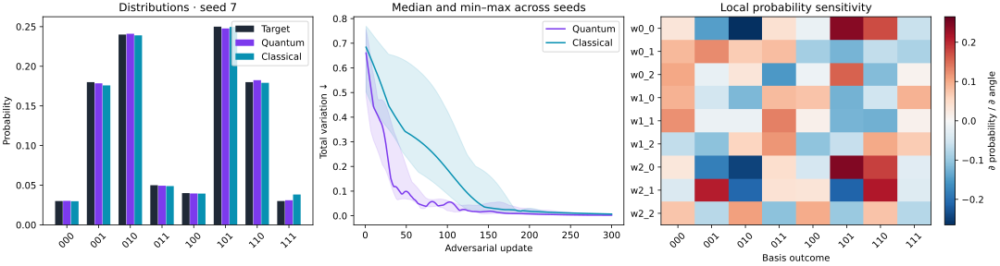
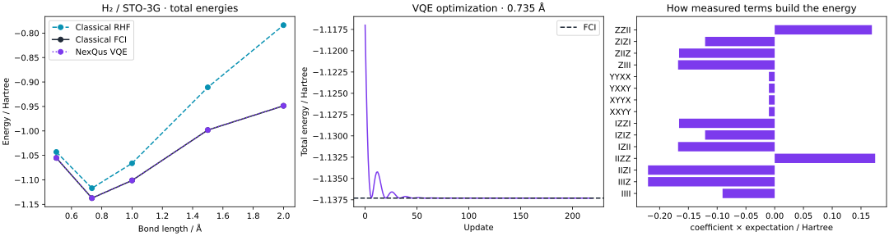

# Local QGAN and H₂ validation — 2026-10-17

These are small-model training/physics checks, **not CPU speed benchmarks**.
No timing comparison, hardware execution or paid cloud task is included.
[Raw results, versions, source hashes and conventions](qgan_h2_20261017.json).
Regenerate full histories and interactive circuit reports with:

```bash
python -m pip install -e '.[tutorial,chemistry]'
python examples/qgan_distribution.py
python examples/h2_vqe.py
```

## Discrete distribution learning



Three-qubit RY/CX generator (9 trainable angles), classical categorical-softmax
generator (8 logits), shared discriminator design (8 logits). Both methods
start from the same initial distribution for each seed, zero discriminator
logits, 300 generator updates and 5 discriminator updates per generator step.
Adam rates: generator .02, discriminator .05. Exact full-distribution training
on the target `[.03, .18, .24, .05, .04, .25, .18, .03]`.

| Seed | Quantum TV ↓ | Classical TV ↓ | Quantum JS ↓ | Classical JS ↓ |
|---|---:|---:|---:|---:|
| 7 | 0.00481441 | 0.00827067 | 0.0000148932 | 0.000268727 |
| 21 | 0.00231615 | 0.00680213 | 0.00000307372 | 0.000121546 |
| 42 | 0.00147708 | 0.00482302 | 0.00000202723 | 0.0000930004 |
| Median | 0.00231615 | 0.00680213 | 0.00000307372 | 0.000121546 |

Quantum has lower final distribution error in these three runs. This comparison
does not match generator parameter count or computational cost, has no held-out
generalization evaluation, and does not compare against optimal classical
estimation. A categorical histogram can represent the supplied target exactly.
Both GANs are iterative fits to that same target.

Training stability matters: an earlier development trial with one discriminator
step and equal .03 learning rates oscillated strongly (median TV quantum
0.472, classical 0.115). The documented five-step settings were then applied to
**both** methods, and all three prespecified seeds are retained here. This
example is not a hyperparameter-search comparison or a guarantee of convergence.

The sensitivity panel is the first seed's final local probability Jacobian;
it is not feature attribution. Shading in the training plot is the min–max
range across three seeds, not a statistical confidence interval.

## H₂ / STO-3G total energies



Neutral singlet, interleaved alpha/beta spin orbitals, four qubits, two electrons,
Jordan–Wigner mapping. All energies are Hartree and include nuclear repulsion.
Each geometry uses newly generated RHF molecular orbitals/integrals. Independent
PySCF FCI and the mapped NexQus exact-sector energy agree within 1e-8 Hartree.
The specialized two-determinant H₂ ansatz uses 220 Adam updates, lr=.04,
starting at the Hartree–Fock determinant for every geometry.

| Bond / Å | Classical RHF | Classical FCI | NexQus VQE | VQE–FCI absolute error / Ha |
|---|---:|---:|---:|---:|
| 0.500 | -1.042996275 | -1.055159794 | -1.055159794 | 3.8e-13 |
| 0.735 | -1.116998997 | -1.137306036 | -1.137306036 | 1.6e-12 |
| 1.000 | -1.066108649 | -1.101150330 | -1.101150330 | 9.7e-14 |
| 1.500 | -0.910873555 | -0.998149353 | -0.998149353 | 9.8e-12 |
| 2.000 | -0.783792654 | -0.948641112 | -0.948641112 | 2.7e-11 |

VQE recovers correlation energy missing from RHF and agrees with classical FCI
for this tiny basis. It does not outperform FCI in accuracy or demonstrate a
speedup. The sparse plotted geometries are not an optimized equilibrium-geometry
calculation. The energy-term plot is evaluated at 0.735 Å and includes the
identity offset; the explorer's ZZII readout is not total energy.

Environment: local NumPy CPU/double, Python 3.12.14, NumPy 2.5.4, PySCF 2.14.0.
PySCF's process-memory lookup needed a local-only peak-RSS fallback because
this runner lacks `/proc/<pid>/statm`; no energy algorithm was changed. Real
Jupyter kernels were blocked locally by a socket permission restriction; all
ten notebooks passed the standalone cell runner, with real Jupyter assigned
to CI. See the PR checks for independent CI results.

The raw snapshot omits per-epoch histories to keep the repository compact.
The example scripts and CI artifacts retain full histories, term contributions,
gate-prefix diagnostics and offline HTML explorers. No full-molecule generation
or drug-discovery pipeline is claimed by this milestone.
