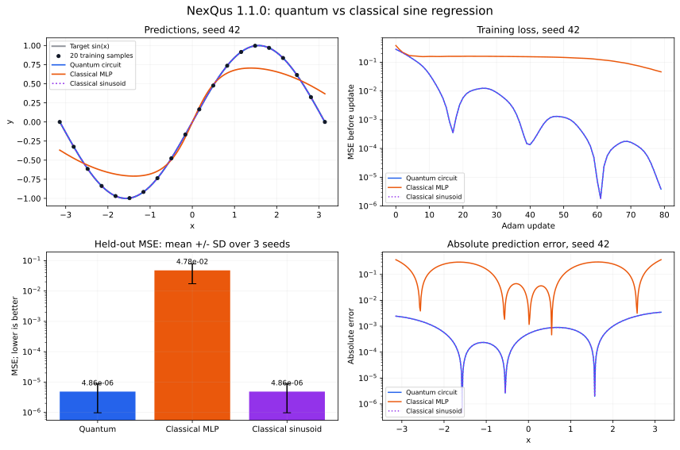

# Trainable quantum circuits

The unreleased optional [image-GAN module](IMAGE_GANS.md) adds a bounded CPU/CUDA
Torch `nn.Module` path for batched probability vectors and autograd, plus
patch/hybrid/classical image generators. Import it from `nexqus.image_gan`.
The core `QuantumFunction` and learning APIs below keep their existing explicit
gradient interfaces; this does not add general Torch autograd to every circuit.

For reusable encoding, entangling layers and data reuploading in the development
checkout, see [QML_TEMPLATES.md](QML_TEMPLATES.md) and lesson 07. Those helpers
build ordinary circuits compatible with the gradients described here.

## Install and run

From the NexQus 1.3.0 source checkout, in your existing environment:

```bash
python -m pip install --upgrade -e .
python -m unittest discover -s tests -v
python examples/validate_gpu.py
python examples/gradients.py
python examples/train_sine.py
python examples/train_classifier.py
python examples/vqe_two_qubits.py
```

## Define an expectation-valued function

```python
from nexqus import Circuit, Parameter, Simulator, QuantumFunction

x, weight, bias = Parameter('x'), Parameter('weight'), Parameter('bias')
template = Circuit(1).ry(weight*x + bias, 0)
function = QuantumFunction(template, observable='Z')

bindings = {'x': 0.3, 'weight': 0.7, 'bias': -0.2}
value, gradients = function.value_and_grad(bindings, wrt=['weight', 'bias'])
print(value, gradients)
```

`function(bindings)` evaluates the expectation. `gradient()` returns a dictionary;
`value_and_grad()` returns the value and dictionary. `wrt=None` differentiates
every named parameter, including inputs; supply `wrt` to train only weights.
String and Parameter names work. All bindings must be finite real scalars and
must exactly cover the template's parameters.

### Gate-local parameter shift

Supported symbolic angle gates are RX, RY, RZ, P and CP. Each has a generator
with a single nonzero eigenvalue gap of one under the SDK's angle conventions.
For one gate angle phi, the derivative is:

    d expectation / d phi = [f(phi + pi/2) - f(phi - pi/2)] / 2

The SDK shifts one gate occurrence at a time, then applies the arithmetic chain
rule for +, -, *, / and sums contributions. This matters when one parameter is
used in multiple gates. For example, RY(theta) followed by RY(2*theta) has
Z expectation cos(3*theta) and derivative -3*sin(3*theta). Shifting theta globally
by pi/2 would not implement the correct gate-local rule in general.

Inverse symbolic circuits and remapped circuit composition are supported.
Constant custom matrices can appear elsewhere in the circuit. Symbolically
parameterized arbitrary matrices are not supported.

The implementation uses NexQus's own circuits, expression derivatives, gate
replacement and simulators. No PennyLane/Qiskit execution dependency is added.
Mathematical references:

- Parameter-shift recipe and conventions:
  https://docs.pennylane.ai/en/stable/code/api/pennylane.gradients.param_shift.html
- Generator frequency formulation:
  https://docs.pennylane.ai/en/stable/code/api/pennylane.gradients.generate_shift_rule.html

## Choose the simulator and noise model

```python
from nexqus import Noise, NoiseModel

noise = NoiseModel(Noise.amplitude_damping(0.02))
function = QuantumFunction(
    template, 'Z',
    simulator=Simulator(backend='torch', device='cuda:0'),
    noise=noise,
)
```

Noiseless statevector and exact noisy density-matrix differentiation are
supported. The `auto` method selects the appropriate representation. The
noise channels and their parameters must be independent of the shifted angle.
Gate labels are preserved in shifted circuits, including inverse labels, so
gate-specific noise rules continue to apply at the same locations.

Trajectory-mode QuantumFunctions are rejected in this release. Finite-shot
gradients, stochastic gradient estimators, noise-parameter derivatives, and
derivatives through measurements/feed-forward are not implemented.

Every evaluation uses shots=0 and retains the state for Pauli expectations.
On CUDA, state evolution and expectation reductions stay on GPU; only scalar
function/gradient results cross into dictionary optimizers. Noiseless Torch
regressors/classifiers batch samples through `TorchCircuit` autograd. Small
circuits can still be faster on CPU. See [GPU.md](GPU.md).

For G relevant parameterized gate occurrences, a value-and-gradient call uses
1 + 2G simulator executions. Shared-parameter contributions are accumulated;
this is not backpropagation through a statevector or a fused reverse-mode pass.

## Explicit optimization

```python
from nexqus import Adam

parameters = {'weight': 0.7, 'bias': -0.8}
optimizer = Adam(lr=0.05)
# Use an application-specific loss to produce the matching gradient dictionary.
gradients = {'weight': 0.1, 'bias': -0.2}
parameters = optimizer.step(parameters, gradients)
```

SGD is also available. Optimizers return a new dictionary and do not mutate the
input parameters. Adam stores moments and a step count; call `reset()` before
reusing it with a different parameter set. Parameters and gradients must have
matching nonempty keys. Higher-order derivatives, clipping, weight decay,
learning-rate schedulers and optimizer checkpointing are not included.

## Regression

```python
import numpy as np
from nexqus import QuantumRegressor, Adam

model = QuantumRegressor(function, input_names=['x'],
                         initial_parameters={'weight': 0.7, 'bias': -0.8})
X = np.linspace(-np.pi, np.pi, 20)
y = np.sin(X)
model.fit(X, y, epochs=80, optimizer=Adam(lr=0.05))
print(model.predict([0.1, 0.5]))
print(model.parameters)
```

Input names map to columns in X. For one input, a one-dimensional array is
accepted. All other template parameters are trainable and need initial values.
The full-batch objective is mean squared error; its classical chain rule is
combined with circuit derivatives. Inputs are fixed during weight training.
Pauli-expectation outputs lie in [-1,1], so targets must be scaled to that
range. There is no classical output head in this release.

`history` records each epoch's loss and parameters BEFORE that epoch's update.
Use `predict()` after training to evaluate the final parameters. `fit()` starts
a fresh history. Passing an existing optimizer keeps its current moment state;
omit it or reset it if a fresh optimization run is intended. Training samples
and gradients are evaluated sequentially, not as a differentiable batch.

`train_sine.py --output-dir results` saves quantum-only training JSON and prediction
CSV. For the visual classical/quantum comparison, use lesson 04 or:

```bash
python -m pip install -e ".[tutorial]"
python examples/compare_sine.py --output-dir results/sine
```

The comparison plots the target, quantum circuit, classical 1-8-1 tanh MLP and
matched classical sinusoid; training loss; held-out MSE across three seeds; and
prediction errors. It exports PNG/SVG figures, metrics JSON and prediction CSV.
All models use the same 20 training samples, 201 disjoint interpolation inputs,
80 Adam updates and learning rate .05. The MLP has 25 parameters; each sinusoidal
model has two. This is one stated MLP configuration, not exhaustive tuning.

The one-qubit circuit represents cos(weight*x+bias), so sine can be learned by
approaching weight=1 and bias=-pi/2. The classical sinusoid uses the same function
family and initialization; its matching predictions are checked numerically.
Read the actual errors and training times separately when comparing models.



The saved example figure comes from the published 1.1.0 NumPy CPU implementation.
Run the notebook or script to reproduce it; training timings depend on the machine.

## Binary classification

`QuantumBinaryClassifier` uses labels 0/1 mapped to targets -1/+1 and the same
MSE training. `predict()` returns binary labels. `predict_proba()` maps the
expectation z to [(1-z)/2, (1+z)/2]; these scores are not guaranteed calibrated
probabilities. Multiclass classification and cross-entropy are not included.
The bundled classification example separates positive and negative scalar
inputs; it is not a benchmark on malware or other production data.

## Variational algorithms

`vqe_two_qubits.py` combines several QuantumFunctions into a weighted Pauli
energy and sums their gradients. It optimizes H=-ZZ-0.5 XI-0.5 IX, then compares
against an independent dense eigensolver. This shows how to build a custom
loss rather than relying only on the built-in MSE models.

## Scope

The published NexQus 1.3.0 APIs provide explicit analytic gradients. General
noisy PyTorch autograd integration, trajectory gradients, dynamic-circuit gradients
and hardware training remain outside those APIs; the source image module has
the narrower Torch bridge described above. The small learning examples demonstrate circuit
optimization; they do not establish an advantage over classical learning.

## Burmese notes

`QuantumFunction` သည် circuit ၏ expectation value နှင့် parameter gradient ကို
တွက်ပေးပါသည်။ Parameter တစ်ခုကို gate များစွာတွင် ပြန်သုံးထားလျှင် gate
တစ်ခုချင်းစီ၏ derivative ကို chain rule ဖြင့် ပေါင်းစည်းပေးပါသည်။

`QuantumRegressor` နှင့် `QuantumBinaryClassifier` သည် Adam သို့မဟုတ် SGD ကို
သုံးပြီး parameter များကို train လုပ်နိုင်ပါသည်။ ဤ version တွင် trajectory
simulation ဖြင့် gradient တွက်ခြင်းနှင့် PyTorch autograd ချိတ်ဆက်မှု မပါဝင်ပါ။
