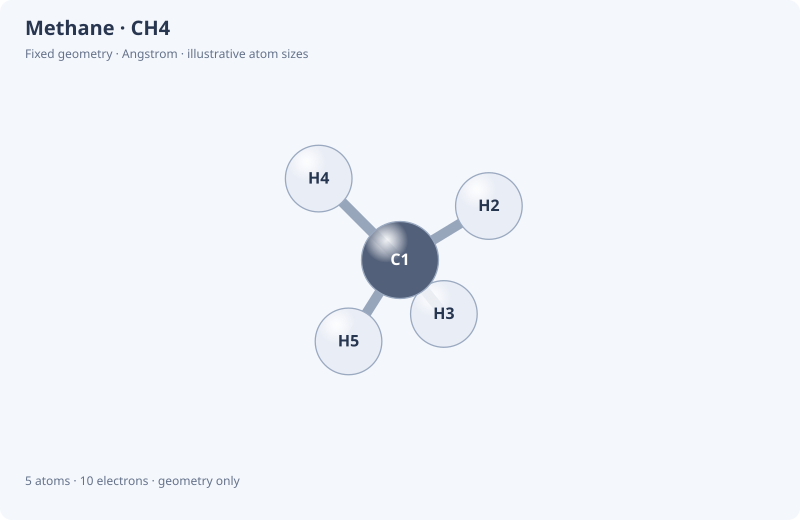
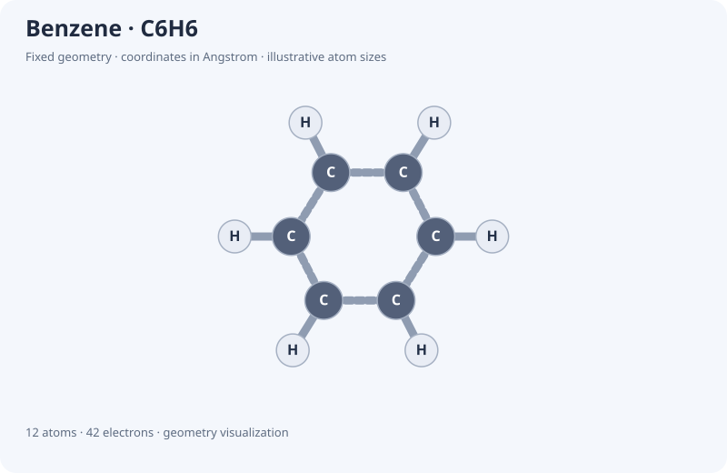

# Molecular structures and energy results

The fixed-H2 example supports `python examples/molecular_viewer.py --device cuda:0`
on native Windows with CUDA-enabled Torch. It accelerates VQE and the bounded
exact energy reference; geometry rendering remains host/browser work. Optional
new-molecule RHF can use GPU4PySCF on Linux/WSL, with integrals and mapping
explicitly retained on CPU. See [GPU.md](GPU.md).

The 1.3.0rc1 candidate supplies a native, offline molecular viewer.
It works on Windows without PySCF, RDKit, a web service or a QPU.

For an immediate preview, open `examples/molecular_previews/gallery.html` or
`examples/molecular_previews/h2_vqe.html` from this checkout. These standalone
snapshots need only a browser; no Python installation is required. The H₂
snapshot contains results generated by the local example below.

```bash
python -m pip install -e ".[tutorial]"
python examples/molecular_viewer.py
```

Open `.release-artifacts/molecules/gallery.html` in a browser to rotate H₂,
methane, water, ethene and benzene. Open `h2_vqe.html` to see the H₂ geometry
with locally calculated VQE and classical reference energies. A file can be
opened directly; no web server is needed. The candidate reports 1.3.0rc1;
the existing published 1.2.0 wheel does not contain these additions.

The prepared HTML snapshots can be refreshed by running the example and copying
its `gallery.html` and `h2_vqe.html` outputs into `examples/molecular_previews/`.



## Notebook use

```python
from nexqus import molecule, molecular_gallery
from IPython.display import display

display(molecule('CH4'))
display(molecular_gallery())
```

Lesson 09 now shows the H₂ structure before its VQE calculation and attaches
the resulting energies to the same fixed geometry. New bilingual lesson 10
introduces the gallery, methane geometry, measurements and custom structures.
Install the updated source and restart the kernel before running these lessons.

Controls:

- Drag to rotate, scroll or use the slider to zoom, and reset the camera.
- Select atoms in the scene or coordinate table; keyboard Enter/Space also works.
- Measure distances using two atoms, or angles using three atoms with the
  second atom as the vertex. Methane's idealized H–C–H angle is 109.471°.
- Toggle labels and atoms/bonds, and use automatic rotation.
- Export the current view as SVG, or fixed geometry/data as XYZ/JSON.

Positions do not change when the camera rotates. SVG is the displayed
orthographic projection; XYZ/JSON retain the original three-dimensional data.
Atom sizes are illustrative and are not electron-density or orbital surfaces.

## Supported example structures

| Example | Atoms | Electrons | Full STO-3G spin-orbital/qubit estimate | Geometry |
|---|---:|---:|---:|---|
| H₂ | 2 | 2 | 4 | Fixed 0.735 Å reference geometry |
| CH₄, methane | 5 | 10 | 18 | Idealized tetrahedron; C–H 1.09 Å |
| H₂O, water | 3 | 10 | 14 | Idealized O–H 0.958 Å; H–O–H 104.5° |
| C₂H₄, ethene | 6 | 16 | 28 | Idealized planar double-bond structure |
| C₆H₆, benzene | 12 | 42 | 72 | Idealized planar aromatic ring |

The basis numbers count all STO-3G spin orbitals for H..Ne. They do not include
active-space or symmetry reduction and do not launch a circuit simulation.
The methane, water, ethene and benzene gallery entries have no energy results
attached. Their coordinates are illustrative model geometries, not optimized
structures from NexQus. CH₄ energy calculations require a CH₄ Hamiltonian and a
suitable electronic-state ansatz; the geometry viewer alone does not supply one.



## Molecule API

```python
from nexqus import Molecule

hydrogen = Molecule(
    ['H', 'H'], [[0, 0, 0], [0, 0, .735]], [(0, 1, 1)],
    name='My hydrogen', geometry_note='Fixed 0.735 Angstrom bond')
print(hydrogen.formula, hydrogen.n_electrons)
print(hydrogen.distance(0, 1))
hydrogen.view().to_html('hydrogen.html')
hydrogen.draw('hydrogen.svg')
hydrogen.to_xyz('hydrogen.xyz')
```

`Molecule(symbols, coordinates_angstrom, bonds=None, *, name='Custom molecule',
charge=0, geometry_note=...)` validates and copies up to 256 atom positions.
The supported elements are H..Ar, Br and I. Bonds use zero-based atom indices
and order 1, 1.5 (aromatic), 2 or 3. Duplicate bonds and coincident atoms are
rejected. Input coordinates are real Angstrom values.

Supply explicit bonds for known connectivity. `bonds=None` infers **single**
bonds using a labelled covalent-radius distance heuristic; it cannot infer
valence, aromaticity or chemical validity. `bonds=[]` means no bonds. Bond order
is a display/connectivity annotation and is not an electronic-structure result.
`distance(a,b)` returns Angstrom; `angle(a,center,b)` returns degrees.

`draw(filename=None)` returns static SVG. `to_xyz(filename=None)` returns XYZ
text. `to_dict()` returns geometry, display and basis-estimate data. A molecule
has a notebook HTML representation; `view()` produces a `MolecularView` with
`to_html(filename=None)` and a copied `to_dict()` payload. A view snapshots the
geometry when created. `MolecularView([molecule1, molecule2, ...])` builds a
custom gallery with up to 32 structures; `molecular_gallery()` supplies examples.

HTML reports use native SVG/JavaScript and isolated notebook frames. Names and
method labels are inserted as text, with JSON script delimiters escaped.
No external assets are fetched. Exported JSON contains the supplied coordinates
and any energy values/metadata attached by the caller.

## Connect a real calculation

```python
from nexqus import Parameter, Adam
from nexqus.chemistry import h2_reference_problem, h2_pair_ansatz

problem = h2_reference_problem()  # fixed 0.735 Å H2/STO-3G fixture
energy = problem.hamiltonian.function(h2_pair_ansatz(Parameter('theta')))
parameters = {'theta': 0.}; optimizer = Adam(.04)
for _ in range(180):
    value, gradient = energy.value_and_grad(parameters)
    parameters = optimizer.step(parameters, gradient)

view = problem.molecule().view(
    energies_hartree={'NexQus VQE': energy(parameters),
                     'Classical exact': problem.exact_energy()},
    calculation_note='H2 / STO-3G / fixed 0.735 Angstrom; total energies include nuclear repulsion')
view.to_html('h2_results.html')
```

`MolecularProblem.molecule()` preserves the problem's atomic coordinates and
charge. The driver-generated `examples/h2_vqe.py` also exports `molecule.html`.
Its PySCF installation still requires Linux/macOS/WSL; the new
`examples/molecular_viewer.py` uses the documented fixed H₂ fixture and works on
native Windows. Both scripts actually run local VQE for their H₂ energy panel.

`h2_reference_problem()` centralizes the previous notebook's PySCF 2.14.0
RHF/STO-3G coefficients, interleaved alpha/beta mode convention and nuclear
repulsion. Tests verify its HF and exact-sector energies. Moving atoms in a
separate geometry object does not update those coefficients: a changed geometry
needs regenerated integrals and a new Hamiltonian.

Attaching `energies_hartree={label: finite_real_value}` requires a nonempty
`calculation_note` naming the method, basis and geometry, and is limited to a
single-structure view. Caller-supplied energies are displayed as supplied; the
viewer does not verify that they were computed for that geometry. Unattached
gallery entries are visibly labelled **GEOMETRY ONLY**.

## Verification

```bash
python -m unittest discover -s tests -p test_molecules.py -v
python examples/molecular_viewer.py
npm install --no-save --no-package-lock jsdom@26.1.0
node scripts/check_molecule_ui.cjs
```

Geometry tests check bond lengths, tetrahedral/water angles, connectivity,
electron/basis counts, H₂ reference energies, exports, limits and HTML escaping.
The DOM suite executes the actual report script to test atom selection,
measurements, drag/automatic rotation, zoom, representations, exports and hostile
labels. It also emits `methane-view.svg` for static visual inspection. DOM tests
do not substitute for complete browser-engine layout verification.
